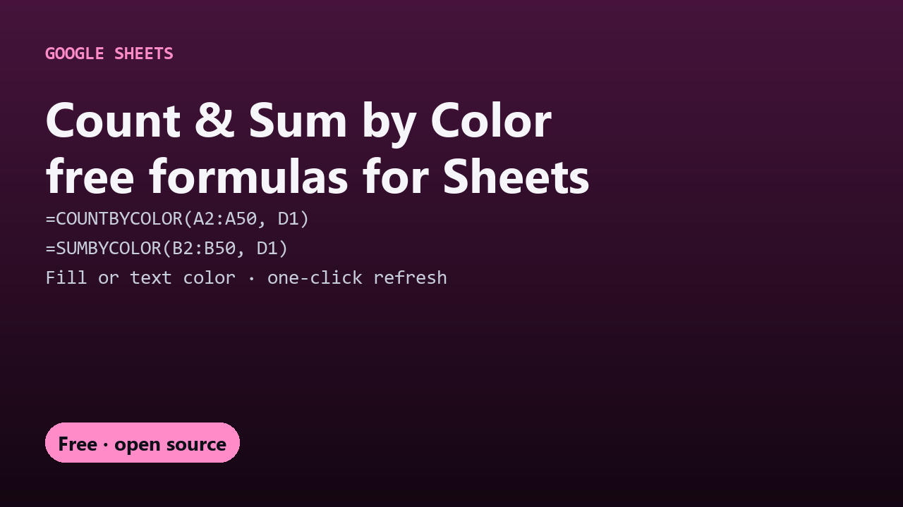

# Free Count and Sum by Color for Google Sheets

Count or sum cells by background or text color in Google Sheets with two free custom formulas, `COUNTBYCOLOR` and `SUMBYCOLOR`. No add-on.

## Guides

- [How to count and sum cells by color in Google Sheets](count-cells-by-color-google-sheets.html)
- [A free Function by Color alternative](function-by-color-alternative-google-sheets.html)

## Get it

The script and full instructions are on GitHub: [DecodedXR/count-by-color](https://github.com/DecodedXR/count-by-color). It's MIT licensed and free.
